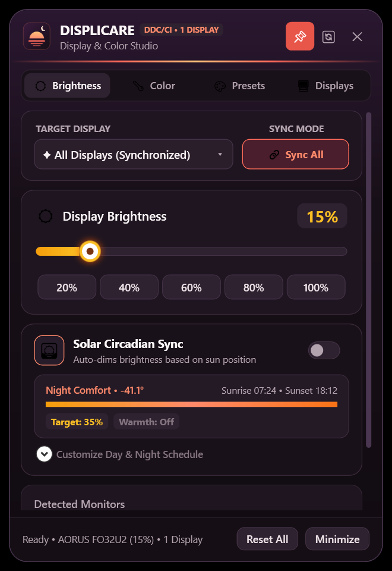

<p align="center">
  
</p>

<h1 align="center">Displicare</h1>

<p align="center">
  Monitor brightness, color and sun-synced dimming for Windows, from the system tray.
</p>

<p align="center">
  <a href="https://github.com/Awaketrk/displicare/releases/latest"></a>
  <a href="https://github.com/Awaketrk/displicare/actions/workflows/build.yml"></a>
  
  <a href="LICENSE"></a>
</p>

<p align="center">
  
</p>

> [!NOTE]
> **Displicare is vibecoded.** It was designed and written through conversation with AI coding assistants (first Google Antigravity with Gemini, then Claude Code), with every build tested by hand on real hardware. The code is reviewed and covered by unit tests, but treat it like any hobby project: try it on your setup before relying on it.

## Features

- **Hardware brightness** over DDC/CI: changes the real backlight of supported monitors.
- **Software brightness** for monitors without DDC/CI, and an **HDR mode**: with Windows HDR on, color temperature, RGB and software dimming stay on the GPU gamma ramp, so games keep VRR (G-SYNC, FreeSync).
- **Color calibration**: color temperature (2500–10000 K), RGB gains, contrast and gamma.
- **Solar Sync**: follows the sun at your location, dimming (and optionally warming) the screen toward night.
- **Presets**: built-in profiles (Night Light, Paper Read, OLED Vivid, Gaming FPS and more), plus your own.
- **Multi-monitor**: control every display together or each one separately; settings are remembered per monitor.
- **Quick brightness**: scroll over the tray icon, or use optional hotkeys, without opening the window.
- **Display setups** (optional): for a PC wired to a desk monitor and TVs in other rooms, save which screens are on, where they go and their resolution, refresh rate, HDR and sound, and switch between them with a click, hotkey or controller.
- **Lightweight**: no dependencies, ~0% CPU when idle, no global input hooks. Calibration is only rewritten when Windows or a game resets it.

## Install

Download the latest release from the [Releases page](https://github.com/Awaketrk/displicare/releases):

- **`Displicare-vX.Y.Z-Setup.exe`**: installs for the current user (no admin rights needed), optionally starting with Windows.
- **`Displicare-vX.Y.Z-Portable.zip`**: unzip anywhere and run; settings stay in that folder.

Each release includes `SHA256SUMS.txt` to verify the downloads.

**Requirements:** Windows 10 or 11 (x64) with .NET Framework 4.8, which current Windows versions include.

## Usage

| Do this | To |
|---|---|
| **Left-click** the tray icon | Open the control window (it hides when you click elsewhere; pin it to keep it open) |
| **Right-click** the tray icon | Quick brightness, presets, Solar Sync, start with Windows, Exit |
| **Scroll** over the tray icon | Change brightness in steps of 5%; a small bar above the taskbar shows the level |
| **Ctrl+Alt+Up / Down** | Change brightness in steps of 10% from anywhere (turn on **Brightness hotkeys** in Displays > General Settings) |

The **Displays** tab shows each monitor's capabilities, switches it between hardware and software brightness, and holds the About card.

**Something not working on your monitor?** Click **Hardware Test…** on the About card. It checks that your displays accept and keep what Displicare writes (gamma ramp, DDC/CI backlight) and saves a report next to your settings; attach it to an [issue](https://github.com/Awaketrk/displicare/issues). The screen dims and changes color for a few seconds while it runs, and everything is put back afterwards.

### Brightness modes

| Mode | Used when | How it dims |
|---|---|---|
| Hardware | The monitor supports DDC/CI (and it's on for that display) | Sets the monitor's own backlight |
| Software | No DDC/CI, or hardware turned off for that display | GPU gamma ramp, down to 8% light in HDR and 22% in SDR (8% with Deeper software dimming) |

Turn on DDC/CI in your monitor's on-screen menu to get hardware brightness.

**Deeper software dimming** (Displays > General Settings, off by default): Windows rejects gamma ramps that stray far from normal, which stops software dimming in SDR at 22% light and the warmest color temperatures early. This toggle lifts that limit with Windows' own `GdiIcmGammaRange` setting, as f.lux's expanded range does. It applies to all apps, asks for admin, works after you sign out or restart, and turning it off puts back what was there. Uninstalling Displicare puts it back too (Windows asks for admin). To undo it by hand, run this in an admin terminal:

```
reg delete "HKLM\SOFTWARE\Microsoft\Windows NT\CurrentVersion\ICM" /v GdiIcmGammaRange /f
```

### Display setups

Turn them on in **Displays > General Settings**. A setup is which screens are on, where they go, and their resolution, refresh rate, HDR and sound. Every connected screen starts with a setup of its own, with a card on the **Setups** tab.

- **Switch here** turns on the setup's screens, the main one as the primary display, and turns the others off. The first time, Displicare asks "Keep this display layout?" and switches back after 15 seconds without an answer, so a TV that can't show the picture never leaves you stuck.
- **⚙ Edit setups…** opens the editor, which works like DisplayFusion's monitor profiles:
  - The setup's screens are drawn to scale. **Drag** one to move it; it snaps to the nearest edge, as in Windows Settings > Display.
  - **Click** a screen to pick its resolution and refresh rate (**Native** and **Highest** unless you choose others) and HDR, make it the **main** screen, or **leave it out**. **+ a screen's name** adds one.
  - **+ New setup** and **Start from what's on now** take the screens on now exactly as Windows has them.
  - Each setup also has its sound output, hotkey, controller direction, and what opens there: **Steam Big Picture** or Windows 11's **Xbox mode**. Leaving such a setup closes it again and minimizes every window, so nothing sits still on screen.
  - Changes are saved as you make them and apply the next time you switch (**Apply** for the setup on screen).
- A screen that isn't connected is left out when you switch, and the others close up around it.
- A one-screen setup remembers what you use there: change the resolution, HDR or sound output in Windows and it keeps it. Displicare never changes which screens a setup turns on or where they go.
- **Delete** a setup you don't need in the editor; its screens stay known, so it doesn't come back on its own.
- **Hotkeys:** Ctrl+Alt+1, 2, 3… switch to each setup.
- **The way back:** Ctrl+Alt+0, or holding **View + B** on a controller for four seconds, goes to the **safe setup** (your desk unless you pick another) without asking, from anywhere: in the middle of a switch, from Big Picture or Xbox mode (which it closes), even when you can't see a screen. If the safe setup can't be applied as saved (its main screen unplugged, Windows refuses the layout), every connected screen comes on instead. `Displicare.exe --room "LG TV"` does the same from a shortcut.
- **Controller:** hold **View + Menu** for a second to open a setup picker (up/down chooses, **A** switches, **B** closes), or press **View + a D-pad direction** to go straight to a setup, even while the TV is still blank: the safe setup is on Up, the others on Right, Left and Down. A and B also answer "Keep this display layout?". It works with Xbox controllers and anything Steam presents as one, and only reads the controller through XInput, as games do, so it's safe with anti-cheat.
- **Streaming:** while Steam Link (or Apollo, Sunshine) streams to a virtual display, your physical screens are switched off so an OLED isn't left showing a still desktop. They come back as they were when the stream ends, with every window minimized.
- After each switch, a short note on the new screen shows the setup, its screens, resolution, refresh rate, HDR and sound.

The controller, turning screens off while streaming, and the note after a switch can each be turned off under **⚙ Edit setups… > All setups**.

> [!TIP]
> While Xbox mode is open, or Game Bar's gamepad cursor is on, Windows keeps the controller to itself, so View + D-pad and View + B can't switch setups. Leave Xbox mode from its menu (Xbox button) or turn the gamepad cursor off in Game Bar first, or use a keyboard hotkey such as Ctrl+Alt+0.

### Settings and command line

Settings and the log live in `%LOCALAPPDATA%\Displicare` (portable builds: next to the exe).

| Option | Effect |
|---|---|
| `--minimized`, `-m` | Start in the tray |
| `--portable`, `-p` | Keep settings next to the exe |
| `--hardware-test` | Open the hardware test and start it right away |
| `--room "<name>"` | Switch to that setup (setups must be on) |

## Known limitations

- **Location is estimated from your time zone.** For exact coordinates, close the app, set `UserLatitude` / `UserLongitude` in `settings.json` and set `AutoLocation` to `false`.
- **Other color tools conflict.** While custom settings are active, Displicare restores its calibration if f.lux, Windows Night Light or a vendor tool changes it.
- **HDR:** everything uses the gamma ramp, worked out for HDR's PQ signal so dimming lowers the light like a backlight (down to 8%) instead of washing colors out. Windows doesn't define the ramp for HDR, so a GPU may handle it differently. Displicare doesn't use the Windows color filter: it would turn off VRR in games.

## Building

Requirements: Windows, the .NET Framework 4.8 Developer Pack, and [Inno Setup 6](https://jrsoftware.org/isinfo.php) for the installer.

```bash
C:\Windows\Microsoft.NET\Framework64\v4.0.30319\MSBuild.exe Displicare.csproj /p:Configuration=Release /p:Platform=x64
```

The app is written to `bin\Release\Displicare.exe`.

### Tests

The test project needs no packages: it's a small console runner that exits with an error if any test fails. Building it also builds the app.

```bash
C:\Windows\Microsoft.NET\Framework64\v4.0.30319\MSBuild.exe Tests\Displicare.Tests.csproj /p:Configuration=Release /p:Platform=x64
```

```bash
.\Tests\bin\Release\Displicare.Tests.exe
```

They cover the brightness and gamma math, the sun-position calculations, settings validation and the setup switching logic (display modes from real EDIDs, arranging screens, layouts, sound output matching).

### Releasing

GitHub Actions builds and tests every push. To publish a release, tag a commit and push the tag:

```bash
git tag vX.Y.Z
```

```bash
git push origin vX.Y.Z
```

The workflow runs the tests, builds the installer and portable zip with `build-release.ps1`, and publishes them as a GitHub Release. To check the packages without publishing, run the **Build** workflow manually from the Actions tab and enter a version. `build-release.ps1 -Version X.Y.Z` does the same locally, writing to `dist\vX.Y.Z\`.

Between releases the version in `Properties\AssemblyInfo.cs` ends in `-test` (e.g. `X.Y.Z-test`), so test builds are easy to tell apart in the About card. The release script replaces it with the plain version.

### Project layout

| Path | What's in it |
|---|---|
| `MainWindow.xaml(.cs)` | The UI, startup and exit. The rest of the window's code is split by area: `.Controls.cs` (sliders, applying settings), `.DisplayCards.cs` (Displays tab), `.DisplayEvents.cs` (reacting to Windows and display changes), `.BrightnessKeys.cs` (tray wheel and hotkeys), `.Presets.cs`, `.Solar.cs`, `.About.cs` and `.Rooms.cs` |
| `MonitorEngine.cs` | Display detection, DDC/CI, gamma ramps, presets |
| `SolarEngine.cs` | Sun position and Solar Sync targets |
| `ConfigManager.cs` | Settings loading/validation and start-with-Windows |
| `HdrHelper.cs` | HDR detection |
| `TrayManager.cs`, `TrayWheel.cs` | Tray icon, menu and mouse wheel |
| `HardwareTest.cs`, `HardwareTestWindow.cs` | In-app hardware test and its report |
| `Rooms/` | Display setups: the setup model, arranging screens, display layouts, EDID modes, sound outputs, controller, on-screen notes, the Setups tab and editor |
| `Tests/` | Unit tests |
| `build-release.ps1`, `installer.iss` | Release packaging |
| `docs/ROADMAP.md` | Ideas for future versions |

## License

[MIT](LICENSE): free to use, modify and share, including commercially, as long as the copyright notice stays with the code.
