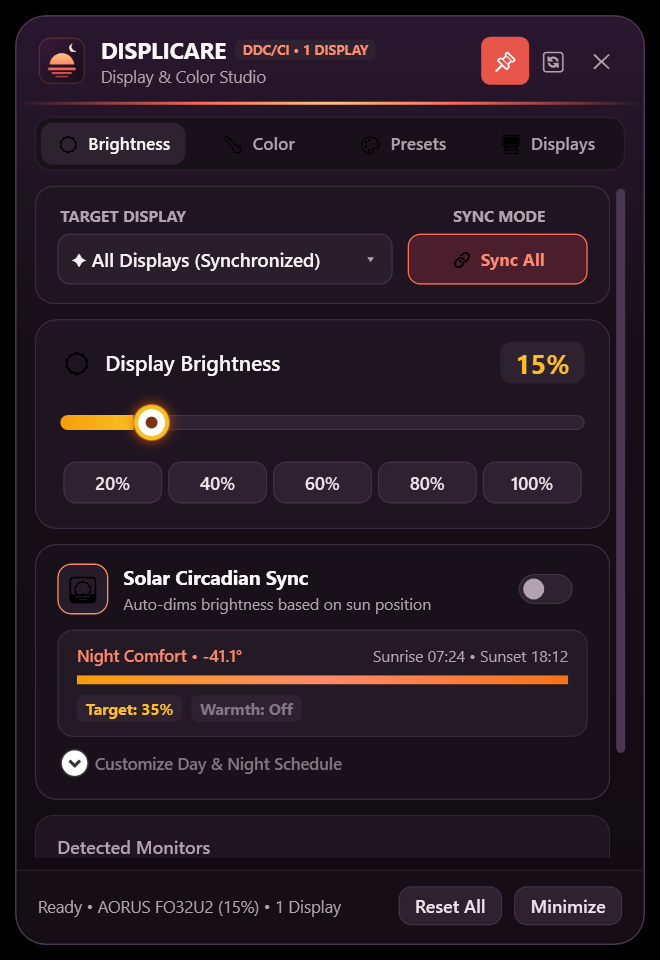

<p align="center">
  
</p>

<h1 align="center">Displicare</h1>

<p align="center">
  Monitor brightness, color and sun-synced dimming for Windows, from the system tray.
</p>

<p align="center">
  
</p>

> [!NOTE]
> **Displicare is vibecoded.** It was designed and written through conversation with AI coding assistants (first Google Antigravity with Gemini, then Claude Code), with every build tested by hand on real hardware. The code is reviewed and covered by unit tests, but treat it like any hobby project: try it on your setup before relying on it.

## Features

- **Hardware brightness** over DDC/CI: changes the real backlight of supported monitors.
- **Software brightness** for monitors without DDC/CI, and a dedicated **HDR mode**: with Windows HDR on, dimming, color temperature and RGB go through a Windows color filter, so they also work in HDR games and video.
- **Color calibration**: color temperature (2500–10000 K), RGB gains, contrast and gamma.
- **Solar Sync**: follows the sun's position at your location, dimming (and optionally warming) the screen toward night.
- **Presets**: built-in profiles (Night Light, Paper Read, OLED Vivid, Gaming FPS and more), plus your own.
- **Multi-monitor**: control every display together or each one separately; settings are remembered per monitor.
- **Lightweight**: no dependencies, ~0% CPU when idle, no global input hooks. Calibration is only rewritten when Windows or a game resets it.

## Install

Download the latest release from the [Releases page](https://github.com/Awaketrk/displicare/releases):

- **`Displicare-vX.Y.Z-Setup.exe`**: installs for the current user (no admin rights needed), optionally starting with Windows.
- **`Displicare-vX.Y.Z-Portable.zip`**: unzip anywhere and run; settings stay in that folder.

Each release includes `SHA256SUMS.txt` to verify the downloads.

**Requirements:** Windows 10 or 11 (x64) with .NET Framework 4.8, which is built into current Windows versions.

## Usage

- **Left-click** the tray icon to open the control window; it hides again when you click elsewhere (pin it to keep it open).
- **Right-click** the tray icon for quick brightness, presets, Solar Sync, start with Windows and Exit.
- The **Displays** tab shows each monitor's capabilities, lets you switch between hardware and software brightness, and has the About card with the version.
- **Hardware Test…** on the About card checks that your displays accept and keep what Displicare writes (gamma ramp, HDR color filter, DDC/CI backlight) and saves a report next to your settings. If something doesn't work on your monitor, attach that report to an issue. Your screen dims and changes color for a few seconds while it runs; everything is put back afterwards.

### Brightness modes

| Mode | Used when | How it dims |
|---|---|---|
| Hardware | Monitor supports DDC/CI (and it's enabled for that display) | Sets the monitor's own backlight |
| Software | No DDC/CI, or hardware turned off for that display | GPU gamma ramp, down to ~30% light |
| Software, HDR | Windows HDR is on | Windows color filter, down to 8% light; also dims HDR content |

Turn on DDC/CI in your monitor's on-screen menu to get hardware brightness.

### Settings and command line

Settings and the log live in `%LOCALAPPDATA%\Displicare` (portable builds: next to the exe).

| Option | Effect |
|---|---|
| `--minimized`, `-m` | Start in the tray |
| `--portable`, `-p` | Keep settings next to the exe |
| `--hardware-test` | Open the hardware test and start it right away |

## Building

Requirements: Windows, the .NET Framework 4.8 Developer Pack, and [Inno Setup 6](https://jrsoftware.org/isinfo.php) for the installer.

```bash
C:\Windows\Microsoft.NET\Framework64\v4.0.30319\MSBuild.exe Displicare.csproj /p:Configuration=Release /p:Platform=x64
```

The app is written to `bin\Release\Displicare.exe`.

### Tests

The test project needs no packages: it's a small console runner that exits with an error if any test fails.

```bash
C:\Windows\Microsoft.NET\Framework64\v4.0.30319\MSBuild.exe Tests\Displicare.Tests.csproj /p:Configuration=Release /p:Platform=x64
```

```bash
.\Tests\bin\Release\Displicare.Tests.exe
```

They cover the brightness and gamma math, the sun-position calculations and settings validation.

### Releasing

GitHub Actions builds and tests every push. To publish a release, tag a commit and push the tag:

```bash
git tag v2.1.1
```

```bash
git push origin v2.1.1
```

The workflow runs the tests, builds the installer and portable zip with `build-release.ps1`, and publishes them as a GitHub Release. To check the packages without publishing, run the **Build** workflow manually from the Actions tab and enter a version.

`build-release.ps1 -Version X.Y.Z` does the same locally, writing to `dist\vX.Y.Z\`.

Between releases the version in `Properties\AssemblyInfo.cs` ends in `-test` (e.g. `2.1.1-test`), so test builds are easy to tell apart in the About card. The release script replaces it with the plain version.

## Project layout

| Path | What's in it |
|---|---|
| `MainWindow.xaml(.cs)` | The UI and the logic tying everything together |
| `MonitorEngine.cs` | Display detection, DDC/CI, gamma ramps, presets |
| `SolarEngine.cs` | Sun position and Solar Sync targets |
| `ConfigManager.cs` | Settings loading/validation and start-with-Windows |
| `ColorFilterDimmer.cs`, `HdrHelper.cs` | HDR detection and HDR dimming |
| `TrayManager.cs` | Tray icon and menu |
| `HardwareTest.cs`, `HardwareTestWindow.cs` | In-app hardware test and its report |
| `Tests/` | Unit tests |
| `build-release.ps1`, `installer.iss` | Release packaging |

## Known limitations

- **Location is estimated from your time zone.** To set exact coordinates, close the app, set `UserLatitude` / `UserLongitude` in `settings.json` and set `AutoLocation` to `false`.
- **Other color tools conflict.** While custom settings are active, Displicare restores its calibration if f.lux, Windows Night Light or a vendor tool changes it.
- **HDR mode** covers all screens at once and can't run together with Windows' own color filters. Contrast and gamma still use the gamma ramp, which Windows doesn't define for HDR, so they may look different there.
